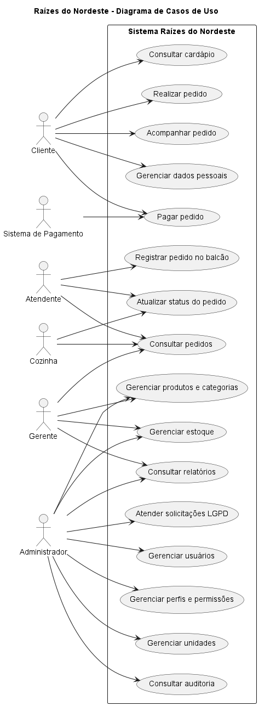
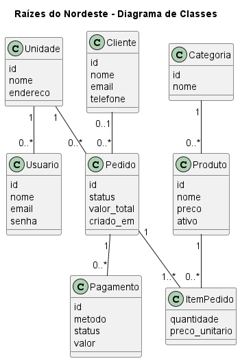

# Arquitetura e decisões técnicas

## Visão geral

```
 Navegador (painel / cliente)          Provedor de pagamento
        │  HTTPS + JWT                        │ webhook assinado (HMAC)
        ▼                                     ▼
 ┌─────────────────────────── API Express ───────────────────────────┐
 │ helmet · rate limit · CORS · validação (zod) · auditoria · erros  │
 │ auth (JWT) → permissões (RBAC) → escopo de unidade                │
 │ módulos: auth, unidades, usuários, perfis, clientes, LGPD,        │
 │          catálogo, estoque, pedidos, pagamentos, relatórios, caixa│
 │ serviços: pedidos.service (máquina de estados) · estoque.service  │
 │ SSE (/api/eventos) ← barramento de eventos em memória             │
 └───────────────────────────────┬───────────────────────────────────┘
                                 ▼
                           PostgreSQL
```

**Tecnologias:** Node.js 20+, Express 5, PostgreSQL 16+, `pg` (SQL direto), zod, JWT, bcrypt, helmet, multer e Swagger UI. O front-end é HTML, CSS e JavaScript puro, sem etapa de build.

Por que **SQL direto** em vez de um ORM: as regras críticas, como a reserva de estoque concorrente, dependem de transações e de `SELECT ... FOR UPDATE`. Com SQL direto elas ficam explícitas e fáceis de revisar em uma avaliação.

## Modelo de dados

| Tabela | Papel |
|---|---|
| `unidades` | Lojas da rede |
| `usuarios`, `perfis`, `permissoes`, `perfil_permissoes` | Controle de acesso configurável. `usuarios.unidade_id` NULL = administração da rede |
| `clientes` | Dados pessoais, preferências (JSONB) e registro de consentimentos |
| `categorias`, `produtos` | Cardápio |
| `itens_estoque`, `produto_composicao` | Insumos e ficha técnica (quanto cada produto consome) |
| `estoque` | Posição por unidade: `quantidade`, `reservado`, `estoque_minimo` (disponível = quantidade − reservado) |
| `movimentacoes_estoque` | Registro imutável de toda movimentação (entrada, saída, ajuste, reserva, baixa, estorno) |
| `pedidos`, `itens_pedido`, `pedido_status_historico` | Pedido com preço congelado e linha do tempo |
| `pagamentos` | Tentativas de pagamento. Um índice único parcial garante **no máximo um pagamento aprovado por pedido** |
| `lancamentos_caixa` | Fluxo de caixa (vendas e estornos automáticos, despesas manuais) |
| `audit_log` | Trilha de auditoria |

As restrições de integridade ficam **no banco**: `CHECK (reservado <= quantidade)`, `CHECK (quantidade >= 0)`, enumerações via `CHECK` e chaves estrangeiras. Assim, nem um erro no código consegue gerar estoque negativo.

## Máquina de estados do pedido

```
AGUARDANDO_PAGAMENTO ──► PAGO ──► EM_PREPARO ──► PRONTO ──► ENTREGUE
        │   ▲             │           │             │
        ▼   │             │           │             └► SAIU_PARA_ENTREGA ──► ENTREGUE (delivery)
PAGAMENTO_RECUSADO        │           │
        │                 ▼           ▼
        └──────────────► CANCELADO ◄──┘
```

- `PAGO` e `PAGAMENTO_RECUSADO` são definidos **apenas pelo serviço de pagamento**, nunca manualmente.
- Pedidos de delivery precisam passar por `SAIU_PARA_ENTREGA`.
- Toda transição é validada e gravada no histórico, com o usuário responsável.

## Estoque

| Evento | Efeito |
|---|---|
| Pedido criado | `RESERVA`: `reservado += q` (os insumos ficam separados) |
| Pagamento aprovado | `BAIXA_PEDIDO`: `quantidade -= q`, `reservado -= q` |
| Recusa / expiração / cancelamento antes do pagamento | `LIBERACAO_RESERVA` |
| Cancelamento após o pagamento, antes do preparo | `ESTORNO`: os insumos voltam |
| Cancelamento em preparo | Os insumos já foram usados; só o dinheiro é estornado |

**Concorrência:** a reserva trava as linhas de estoque (`FOR UPDATE`) sempre na mesma ordem (por `item_estoque_id`), o que evita *deadlocks*. Um teste dispara 5 pedidos simultâneos para 5 unidades de um item, 2 por pedido, e confirma que exatamente 2 são aceitos.

**Expiração:** uma rotina roda a cada minuto e cancela os pedidos não pagos há mais de `PEDIDO_EXPIRACAO_MIN` minutos, liberando a reserva. Assim o estoque não fica preso por clientes que desistiram.

## Pagamentos

- Existe um **contrato único** para os gateways (`criarCobranca`, `estornar`, `interpretarWebhook`) e duas implementações: `mock` (testes e demonstração) e `mercadopago`. Trocar de provedor não mexe nas regras do pedido.
- **Idempotência:** cada tentativa tem uma `idempotency_key` enviada ao provedor. Webhooks repetidos são ignorados, porque só um pagamento `PENDENTE` pode mudar de estado.
- **Autenticidade:** os webhooks só são aceitos com assinatura HMAC-SHA256 válida, comparada em tempo constante. No Mercado Pago, o status ainda é **reconsultado na API oficial**.
- **Casos de borda tratados:**
  - Um PIX aprovado depois que o pedido foi cancelado, ou já pago por outra tentativa, gera **estorno automático**.
  - Se o provedor estiver fora do ar, a API responde 502 e o pedido continua aguardando pagamento.
  - Se o estorno falhar, o cancelamento inteiro é desfeito, o que mantém os dados consistentes.
- Os dados do cartão nunca passam pelo servidor, que recebe apenas o token do provedor.

## Tempo real

`GET /api/eventos` é um canal Server-Sent Events. O quadro da cozinha recebe `pedido.criado` e `pedido.atualizado`, e a tela de estoque recebe `estoque.alerta`, sem recarregar a página. Os eventos são filtrados pela unidade e pelas permissões do usuário. O painel se reconecta sozinho se a conexão cair.

> Para rodar várias instâncias da API, basta trocar o barramento em memória (`src/utils/eventos.js`) pelo `LISTEN/NOTIFY` do PostgreSQL ou pelo Redis. A interface de publicação continua a mesma.

## Segurança (resumo)

| Ameaça | Medida |
|---|---|
| Força bruta | Bloqueio da conta após 5 falhas (15 min) + limite de requisições por IP no login |
| Descoberta de e-mails | Mesma mensagem e mesmo tempo de resposta para e-mail inexistente e senha errada |
| Token forjado | JWT HS256 com algoritmo fixo (rejeita `alg=none`); segredo obrigatório em produção |
| Acesso indevido | Permissões verificadas em cada rota; escopo por unidade; perfil recarregado do banco a cada requisição (a desativação vale na hora) |
| Escalonamento de privilégio | Ninguém atribui um perfil com permissões que não possui; o perfil ADMIN é protegido |
| SQL injection | 100% das consultas parametrizadas |
| XSS | CSP restritiva (`script-src 'self'`), escape de todo dado no painel, `nosniff` |
| Upload malicioso | Tipo validado pelos *magic bytes*, limite de 2 MB, nome de arquivo aleatório |
| Vazamento de informação | Erros 500 genéricos em produção; logs sem query string, corpo ou senha |
| Injeção em planilhas | Células do CSV iniciadas por `= + - @` são neutralizadas |

## Disponibilidade

- `GET /api/health` verifica a API e o banco (pode ser usado por monitores de disponibilidade).
- Encerramento gracioso (SIGTERM): termina as requisições em andamento e fecha o pool de conexões.
- Pool de conexões com timeouts; erros em conexões ociosas não derrubam o processo.
- Timeouts nas chamadas ao provedor de pagamento (20 s), para que uma falha externa não trave a API.

## Diagramas do Sistema

### 1. Diagrama de Casos de Uso
Representa os usuários do sistema e as principais funcionalidades disponíveis.



### 2. Diagrama de Classes
Representa as principais classes do sistema e seus relacionamentos.



### 3. Diagrama Entidade-Relacionamento (DER)
Representa as principais entidades do banco de dados e seus relacionamentos.


